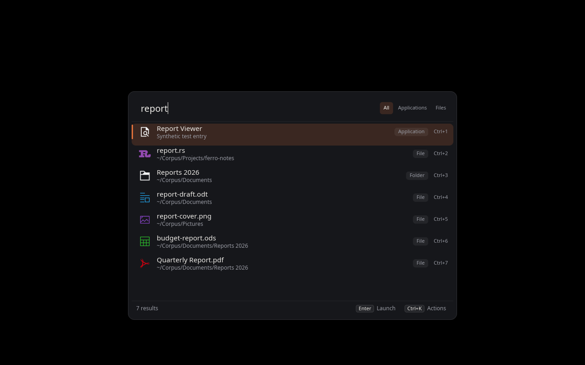

# FerroSeek

[](https://github.com/Lucenx9/ferroseek/actions/workflows/ci.yml)

**A keyboard-first Linux launcher for applications, files and calculations.**

Type an application name, find a file in your indexed folders, or calculate a
result. Open it with Enter. FerroSeek combines a Wayland launcher with its own
Rust file search engine and keeps launch history locally.



Screenshot from a nested test session with sample files.

**Status: experimental, 0.1 development.** Requires Wayland with
`wlr-layer-shell` and session D-Bus. Graphical testing currently uses nested
virtual KWin; other compositors have not been verified. No binary release has
been published yet.

## What you can do

- Launch installed applications using names, keywords and fuzzy matching.
- Run application actions such as new or private windows from the actions menu,
  when the application's `.desktop` file declares them.
- Find files and folders by name or path in configured indexing roots.
- Calculate expressions such as `(2+3)*4`, `sqrt(2)` and `2^10`; Enter copies the result.
- Open a file, reveal it in its folder or copy its path through keyboard actions.
- Pin applications and files as favorites at the top of the home suggestions.
- Revisit frequently opened applications and files with local, decaying history.
  Use `--private` to avoid recording a session.

File results come from an index updated with inotify. Search covers filenames
and paths, not file contents. FerroSeek has no telemetry or remote search service.

## Install

Source installation requires Python 3.11+, Rust 1.89+ with Cargo, a C
compiler/linker and libxkbcommon development files. On Debian/Ubuntu the latter
package is `libxkbcommon-dev`; on Arch it is `libxkbcommon`.

```sh
git clone https://github.com/Lucenx9/ferroseek.git
cd ferroseek
./scripts/install.sh --launcher
```

This installs `ferroseek-launcher`, the indexing daemon and the CLI under your
user account, without sudo. Existing configuration and indexes are preserved;
installation does not start or restart indexing. Review your roots before the
first file query, which can activate the daemon. The engine defaults to your
home directory with exclusions.

```sh
ferroseek config --default              # inspect the default configuration
# Set roots in ~/.config/ferroseek/config.toml before searching for files.
ferroseek-launcher
```

Bind `ferroseek-launcher` to a shortcut in your desktop or compositor settings.
Running the command again closes the open launcher. The installer does not
register a global shortcut or change desktop settings.

Use `./scripts/install.sh` for guided setup, or `--dry-run` to inspect its plan.
See [installation and upgrades](docs/INSTALLATION.md) for XDG paths, indexing
configuration, optional service enablement, archives and uninstall.

## Keyboard controls

| Key | Action |
|---|---|
| Up/Down, Tab/Shift+Tab | Select a result |
| Ctrl+Up/Ctrl+Down | Jump to the previous/next result group |
| Enter | Launch, open or copy a calculation |
| Ctrl+K | Show actions for the selected result |
| Ctrl+Tab / Ctrl+Shift+Tab | Switch between All, Applications and Files |
| Ctrl+1…8 | Run a visible result or filtered action by its displayed number |
| Ctrl+Enter | Reveal a file or continue a calculation from its result |
| Ctrl+Shift+C | Copy a file path |
| Esc | Close actions, clear the query, then close the launcher |

More navigation keys and history settings are in the [launcher guide](docs/LAUNCHER.md).

## Current limits and next steps

The window currently has a fixed size and position and one dark appearance.
Themes and layout configuration are planned. Application focus depends on the
compositor because the UI cannot yet supply an XDG activation token.

The next priorities are real desktop validation, reliable activation, clear
first-run indexing setup and appearance settings. Window switching, clipboard
history, web search and a plugin API are not implemented. See the [roadmap](docs/ROADMAP.md).

## Engine and optional tools

The engine and CLI also work without the graphical launcher:

```sh
./scripts/install.sh --core
ferroseek index                         # foreground indexing without a daemon
ferroseek search report
ferroseek search --in ~/Documents cv
ferroseek status
```

An optional [MCP server](docs/MCP.md) exposes read-only filename/path search to
AI clients. Install it with `--mcp`; registration is separate. Desktop launcher adapters are not included.

## Documentation and development

- [Launcher](docs/LAUNCHER.md): requirements, controls, history and limits.
- [Installation](docs/INSTALLATION.md): components, upgrades and removal.
- [Architecture](docs/ARCHITECTURE.md): launcher, daemon, search and index.
- [Roadmap](docs/ROADMAP.md): implemented features and priorities.
- [Other Linux launchers](docs/LINUX_LAUNCHERS.md): repository research and presentation choices.
- [Benchmarks](docs/BENCHMARKS.md): engine measurements and their limits.
- [Search tools](docs/COMPARISONS.md): background on indexed and live filesystem search.

```sh
cargo build --release --locked --workspace
cargo test --workspace --locked
cargo fmt --all --check
cargo clippy --workspace --all-targets --locked -- -D warnings
```

Repository conventions are in [CLAUDE.md](CLAUDE.md).
Licensed under [GPL-3.0-or-later](LICENSE).
