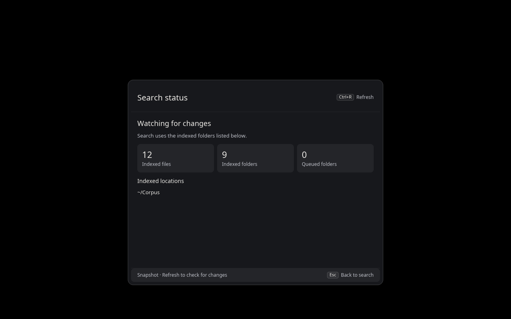
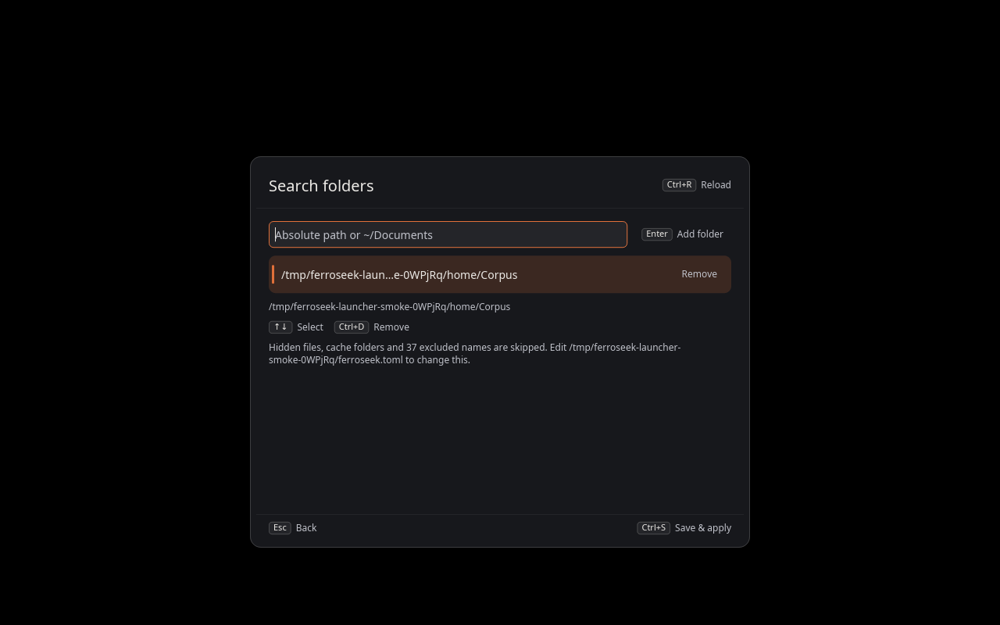
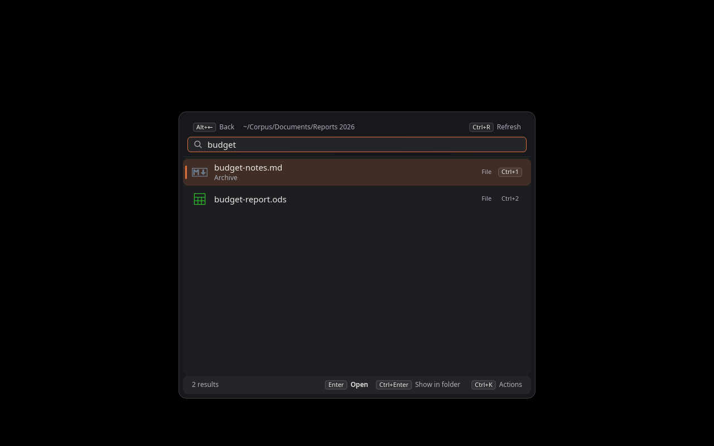
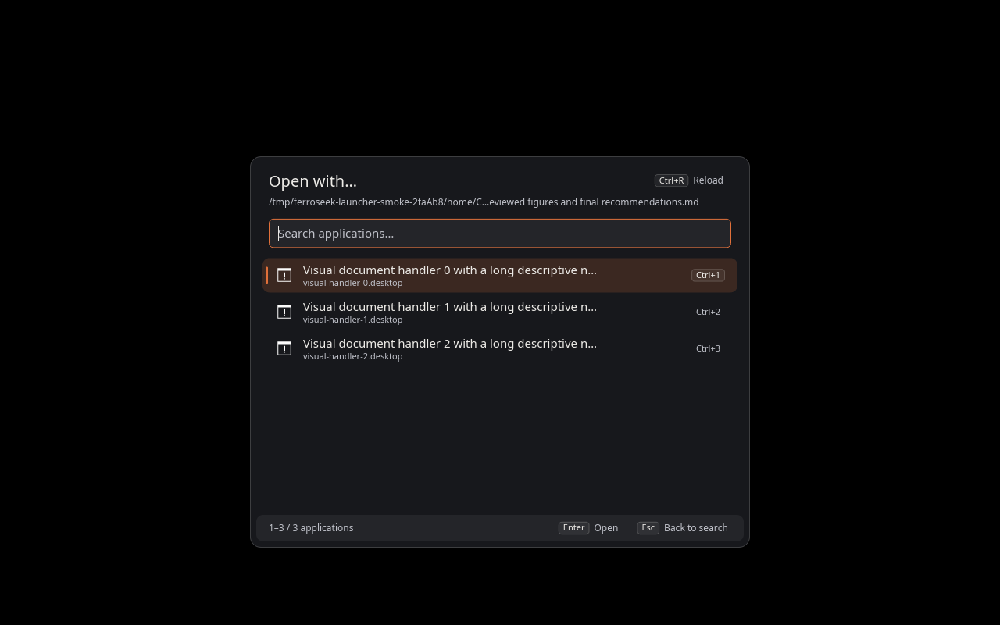
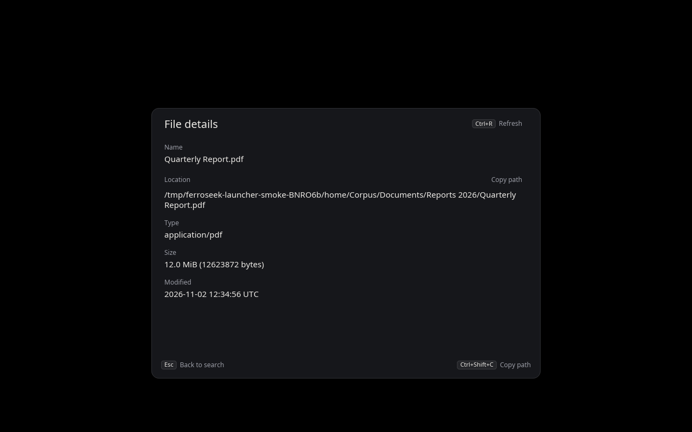
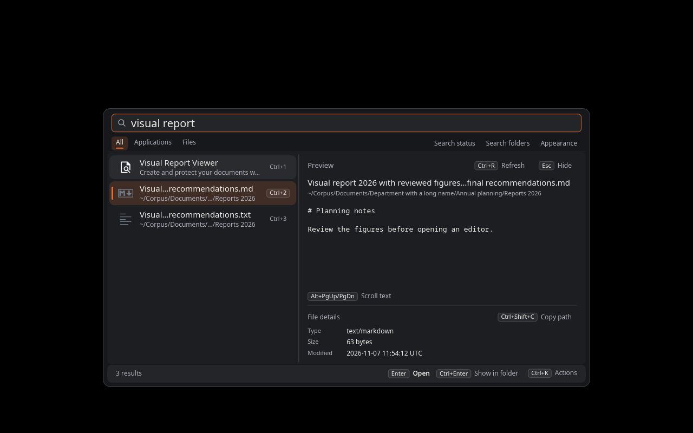

# FerroSeek launcher (`ferroseek-launcher`)

FerroSeek's main user interface is a keyboard-first Linux launcher for
applications, files and calculations on Wayland. It draws a layer-shell overlay, asks the running
`ferroseekd` for file results and launches applications from their
freedesktop desktop entries. It is a separate process: it never opens or
writes the index and adds no background service.

**Status:** experimental. Built and tested in a nested, virtual KWin
(Plasma 6). Other compositors that implement `wlr-layer-shell` should work
but have not been tested. The installer manages the launcher and its search engine with `--launcher`.

## Build and run

Building needs the libxkbcommon development files (`pkg-config xkbcommon`;
`libxkbcommon-dev` on Debian/Ubuntu, `libxkbcommon` on Arch), which a
dependency of the layer-shell backend probes at build time.

```sh
./scripts/install.sh --launcher  # builds and installs launcher + daemon + CLI
ferroseek-launcher            # opens; run it again to close it
```

Bind the command to a key yourself, e.g. in KDE System Settings → Keyboard →
Shortcuts → *Add New* → *Command or Script*. The launcher never registers
global shortcuts or changes desktop settings. Running it while it is open
closes the open instance (single instance via the session-bus name
`io.github.ferroseek.Launcher`).

| Option | Effect |
|---|---|
| `--query TEXT` | start with `TEXT` already typed |
| `--private` | do not record anything opened in this session |
| `--forget-history` | delete the launch history and exit |

The installer preserves configuration and indexes and does not start indexing
unless `--enable` is supplied. Review indexing roots before enabling it.
`./scripts/uninstall.sh --launcher` removes only the launcher and retains
the engine and integrations. See [installation](INSTALLATION.md).

## Keys

| Key | Action |
|---|---|
| Up/Down, Tab/Shift+Tab, Ctrl+N/Ctrl+P | move the selection |
| Ctrl+Up/Ctrl+Down | first row of the previous/next result group; no wrap |
| Page Up/Page Down, Ctrl+Home/Ctrl+End | move by a page, to the first/last row |
| Enter | launch the application, open the file, copy a calculator result |
| Ctrl+Tab / Ctrl+Shift+Tab | Switch between All, Applications and Files |
| Ctrl+1…8 | Run a visible result or filtered action by its displayed number |
| Ctrl+Enter | show the file in its folder, or reuse a calculator result |
| Alt+Right / Alt+Left | Search in the selected folder / return to the previous search |
| Ctrl+K | open/close the searchable action panel for the selected row |
| Ctrl+I | open/close file search status |
| Ctrl+R | refresh while file search status is open |
| Shift+F10, Menu key | open actions for the selected row |
| Ctrl+Shift+C | copy the file's path |
| Esc | clear the action filter, close actions, clear the query, return from folder search, then close |

Choose **All**, **Applications** or **Files** beside the search field to narrow
results without rewriting the query. Ctrl+Tab cycles forward; Ctrl+Shift+Tab
cycles backward. The choice lasts for this launcher session. Applications mode
makes no file-search requests; Files shows indexed files and recent file
suggestions. Calculator expressions without `=` appear only in All; an explicit
`=` query works in every mode. Switching modes closes actions and resets the
selection; replies from earlier searches are ignored.

Type in the action panel to filter its commands without changing the search
query or selected result. Action search accepts abbreviations such as `copnm`
for **Copy name**, and alternatives such as `reveal` for **Show in folder** or
`continue` for **Use result**. Every query word must match; closer label matches
appear first, and an empty filter restores the original order. Enter runs the
highlighted matching action. Ctrl+1…8
runs the corresponding visible row; numbers follow the window after scrolling
and the matching actions after filtering. The top number-row positions also
work on layouts such as AZERTY, where typing digits normally requires Shift.
Missing numbers do nothing. File
shortcuts remain available while filtering. After copying, the launcher stays
open and returns focus to the main search field. Clicking the main field and
typing closes actions and starts the new search.

The panel shows up to eight actions at a time. Up/Down and the mouse wheel move
the selection; Page Up/Page Down move by a page, and Ctrl+Home/Ctrl+End reach
the first/last action. A range indicator appears for longer menus. Numbers
always refer to the currently visible actions.

Click a result once to select it; double-click or press Enter to open it.
Right-click a result to select it and open its actions, or click **Actions**
in the footer. A click on a result that disappears while results update is
ignored rather than opening a different row. Action clicks also keep the target
and action they were drawn for; changing a filter cannot redirect a queued click
to another command.

## Results

- **Applications** come from `.desktop` files in `$XDG_DATA_HOME` and
  `$XDG_DATA_DIRS`, parsed by the launcher itself (Desktop Entry
  Specification: ID masking, localized names and keywords, `Hidden`,
  `NoDisplay`, `OnlyShowIn`/`NotShowIn`, `TryExec`). Strong name or keyword
  matches are shown above files, weak ones (description only, loose
  subsequence) below them.
  The actions menu also lists the application's declared `.desktop` actions,
  such as **New window** or **New private window**, using their localized names
  and declared order. Search and Enter, a click, or a displayed Ctrl+1…8 shortcut
  runs the chosen action. Only listed actions with a name and a usable `Exec`
  command are shown; actions requiring D-Bus activation without an `Exec`
  fallback are not supported. These commands use argument vectors, the app's
  terminal preference and working directory, and the normal launch scope.
- **Files and folders** come from the daemon's `io.github.ferroseek.Search1.Search`
  method; opening and revealing go through its `Open` method, which only
  opens indexed paths. Calling the daemon's bus name D-Bus-activates it.
- **Calculator:** an arithmetic expression (`(2+3)*4`, `sqrt(2)`, `2^10`)
  shows its value; Enter copies it. Prefix with `=` for calculator-only
  results, including plain numbers (`= 42`), constants (`= pi`) and scientific notation
  (`= 1e-12 * 2`). Ctrl+Enter or **Use result** replaces the expression with
  its answer so you can append another operation. Continued calculations
  retain full precision; copied answers use the displayed precision.
  A fixed grammar is evaluated in process; nothing is passed to a shell or
  interpreter.
- **Empty query:** the most often opened applications and files that still
  exist, followed by available applications to fill the suggestions. Removed
  items do not use up a suggestion slot.
- **No matches:** the query remains visible with a suggestion to refine it;
  Esc clears the search.

Applications start without a shell, from the parsed `Exec` argument vector,
in their own transient systemd user scope when a user manager is available.
`Terminal=true` entries run in `xdg-terminal-exec` or a known terminal.

## Slow or disconnected search services

File search calls wait up to five seconds, and file open/reveal calls up to
fifteen seconds, including service activation. The launcher does not retry
these calls automatically. A timed-out search leaves an error; typing a new
query starts a new search, and replies for older queries remain ignored.

An open request can take effect even if its confirmation is lost. On timeout,
connection loss or an ambiguous service failure, a persistent footer warns
that the open was not confirmed. No launch history is recorded, and further
application/file open actions are blocked for that launcher session to avoid
sending a duplicate. Check the desktop, then close and reopen FerroSeek before
trying again. Search, copy actions, calculations and index status remain usable.
A definite rejection, such as an unindexed path or invalid arguments, allows
an explicit new attempt after the issue is corrected. Only confirmed success
records file usage and closes the launcher.

## File search status

Click **Index status** beside the search filters, or press Ctrl+I, to check the
search service without leaving the launcher. Empty file searches and search
errors also offer **Check file search status**. Esc or **Back to search** returns
to the same query, filter and selected result.



Screenshot from a nested test session with sample files.

The view distinguishes starting, indexing, watching for changes, paused and
stopping states. It shows indexed file/folder counts, queued folders and indexed
locations. Counts describe the index, not the current query's results or a
completion percentage. A folder-watch limit warning indicates that some changes
may not be detected promptly; the error count is cumulative for the service
session and does not mean every reported error is still unresolved.

Opening the view requests a snapshot and can D-Bus-activate the search service.
It does not poll in the background. Use **Refresh** or Ctrl+R for a new snapshot;
only one status request is sent at a time. Up/Down, Page Up/Page Down,
Ctrl+Home/Ctrl+End and the mouse wheel scroll the details. If status cannot be
retrieved, the view shows an error with retry and return controls; missing data
is not displayed as zero. Applications and calculations remain usable.
Status calls time out after three seconds so a stalled diagnostic reply cannot
hold up later file searches or open actions indefinitely. Refresh can retry.

This view does not edit configuration or pause/resume indexing. Use **Folders**
or Ctrl+, to choose search locations. Install or update the launcher and daemon
together to use the status and folder interfaces.

## Search folders and initial setup



Screenshot from a nested test session with sample folders.

If the configuration file is missing, the launcher opens **Search folders** before
sending any file queries, including a `--query` prefill. Review the default home
folder, add or remove folders, then use **Save & apply** (Ctrl+S). Choosing no
folders disables file indexing. Esc closes an unsaved first-run screen without
creating a configuration or starting the service. CLI and explicitly enabled
services retain their existing configuration/default behavior.

Later, open **Folders** in the search header or press Ctrl+,. Empty file results
also offer **Choose folders**. Type an absolute path or `~/Documents` and press
Enter to add it; use Up/Down to select a folder and Ctrl+D or **Remove** to remove
it. New folders must exist, be readable directories and not be symbolic links;
existing offline locations can be retained. Nested locations are covered by the
parent. The selected full path wraps below the list. Page Up/Down, Ctrl+Home/End
and the wheel scroll the details. Exclusions are shown read-only, with active
service settings distinguished from saved settings when the service is absent.
Viewing this screen does not activate the service.

Saving changes only `roots` in the TOML file and preserves other settings and
surrounding comments. Writes use a locked, atomic replacement with private file
permissions. A stale file snapshot is refused; **Reload** (Ctrl+R) reloads disk
settings after confirming discard of unsaved edits. Esc keeps editing when a
discard prompt is visible; Ctrl+D explicitly discards. Invalid or symlinked
configuration files are not overwritten. Symlink targets must be edited separately.

**Save & apply** explicitly starts the service if necessary, then applies the
saved folders without a restart. Removing a location removes its indexed entries
and watches, never user files. Indexing continues in the background and a paused
service stays paused. Other saved settings are not applied to an already running
service; a message reports if they still need a service restart. A service using a
different configuration file refuses the application. Errors preserve the draft;
if saving succeeded but application could not be confirmed, settings remain saved
and Ctrl+S can safely retry. Applying times out after 30 seconds; older daemons
without this method must be updated. The screen cannot close during saving or
application; after a failure, Esc returns to search and refreshes its file results.

## Search in a folder



Rendered in a private virtual KWin session with a synthetic indexed tree.

Select a folder result and press **Alt+Right**, or choose **Search in folder**
from Actions (Ctrl+K; search for `within`). The header shows the captured location.
Type at least two characters to search indexed files and folders strictly below
that location, including subfolders. Query syntax and ranked result limits match
normal file search. This is an indexed subtree search, not a list of immediate
folder contents; an empty field shows a prompt.

The query and folder URL travel separately, including paths with spaces or
non-UTF-8 bytes. Unavailable, unindexed or symbolic-link folders are refused
without broadening the search. Ctrl+R retries the current search. Index coverage
can lag behind filesystem changes.

A selected child folder can narrow the search again. **Alt+Left** or the header's
**Back** button restores the previous query, result filter and selected target
when it remains available. Esc clears the action filter/menu, then the current
query, then returns to the previous search. Return history is bounded and lasts
only for this launcher session. Returning shows the previous results immediately
and refreshes them; late replies cannot overwrite the current context.

Folder searches contain no global suggestions, apps or calculator results. The
All/Applications/Files filter is unavailable until returning to global search.
File actions, including Open with, File details and Preview text, remain available. Ctrl+I
opens index status; Ctrl+comma opens folder settings. Applying folder settings
returns to global search with the original query. Searching and moving between
contexts do not record launch history. Matching launcher and daemon versions are
required.

## Open with a selected application



Rendered in a private virtual KWin session with synthetic document handlers.

For a file result, open **Actions** (Ctrl+K), search for **Open with…** and press
Enter. Choose an application with Up/Down and Enter, a displayed Ctrl+number,
or a click. Typing filters application names and desktop IDs; the ID beneath
its name helps distinguish similarly named apps. Page Up/Down, Ctrl+Home/End
and the mouse wheel navigate longer lists.

The chooser stays bound to the original file while results finish loading.
Esc clears a nonempty application filter; Esc again returns to the same search
query, scope and file selection when that file is still present. Ctrl+R reloads
the application list. Loading, empty and error states are distinct; a failed
read can be retried. The list is requested only when opening or reloading this
view, rather than on each filter keystroke.

Choosing an application is a one-time action. It does not change MIME defaults
or save a preferred application. The daemon checks that the file is still
indexed and available and that the chosen desktop ID is still eligible before
launching it. Failures keep the chooser available; a launch with an uncertain
reply uses the same duplicate-open protection as normal file opening. History
is recorded only after daemon acknowledgement.

Compatibility: this first version lists installed desktop entries declaring the
file's detected MIME type, an alias or a parent type and accepting one `%f`,
`%F`, `%u` or `%U` document field. Single-file `%f`/`%u` can also appear within
an option argument; list fields `%F`/`%U` must stand alone. It includes `NoDisplay` document handlers,
honours hidden-entry masks, visibility and `TryExec`, and never accepts a caller-supplied command. Type
detection uses filename metadata from shared-mime-info and does not read file
contents. Unrecognized types, folders and symbolic links are not supported by
the chooser; normal **Open** remains available. Desktop association preference
overrides and applications with only D-Bus activation are not included. Install
matching launcher and daemon versions for this interface.

## File details



Rendered in a private virtual KWin session with a synthetic file.

For an indexed regular file, open **Actions** (Ctrl+K), search for **File details**
or `properties`, and press Enter. The view shows the full name and location,
detected MIME type, current size and last modification time in UTC. Sizes include
an exact byte count. An unknown type is shown explicitly.

The daemon reads filesystem attributes on request, including while indexing is
paused; it does not read file contents. Ctrl+R refreshes the details. Loading and
errors have distinct states, and failed reads can be retried. Late replies cannot
replace a newer view or change the captured file. Esc returns to the original
query, scope and selected file if it remains in the results. Up/Down, Page Up/Down
and Ctrl+Home/End scroll long details.

Use **Copy path** or Ctrl+Shift+C to copy the captured location. For a path that
cannot be represented as UTF-8 text, the view shows and copies its lossless file
URL instead. Viewing, refreshing and copying details do not record launch history.
Folders and symbolic links are not supported by this view. Matching launcher and
daemon versions are required.

## Text preview



Rendered in a private virtual KWin session with a synthetic file.

Choose **Preview text** from a regular file's Actions menu (Ctrl+K; search for
`preview` or `contents`), or press Enter in **File details**. It enables a sidebar
beside the results, with text and current type, size and modification time. File
details closes back to results when enabling the sidebar.

No content is read merely by opening the launcher or selecting results while
preview is disabled. Once enabled, the sidebar follows the selected regular file:
navigation, search editing and result-filter changes can start a new content and
metadata read. A new query clears the old text immediately. Applications, folders
and empty results show a prompt without reading content. Late responses cannot
replace the current target. A stable selected target does not reread just because
results were reordered.

**Hide** or Esc closes the sidebar before clearing the search; it preserves the
current query, filter and selection and stops reads on subsequent navigation.
Preview stays enabled only for the current launcher session. Modal screens such as
index status, folder settings, File details and Open with hide the sidebar and
pause new preview reads. Returning resumes it for the current selected file.
Opening, refreshing or copying a preview does not record launch history.

The view displays plain text, including Markdown or HTML source without rendering
or executing it. Supported MIME types are `text/*`, JSON, XML, JavaScript, TOML and
YAML, determined by the system MIME filename database. Unknown types, binary
control characters (including terminal ESC sequences, DEL and C1) and invalid UTF-8
in the inspected prefix have a distinct
unsupported state. Empty files are identified explicitly. PDF, images and other
rich previews are not available. Glyph coverage depends on installed desktop fonts.

Reads inspect at most 64 KiB plus one truncation-detection byte. Display is limited
to 16,384 Unicode characters and 200 logical lines, whichever limit is reached
first; a clipped preview says **Beginning of file**. An incomplete UTF-8 sequence
at the byte boundary is omitted. CRLF, CR and form-feed page breaks display as LF. These
limits apply before visual wrapping; the remainder of the file is not validated.

Up/Down, Page Up/Down and Ctrl+Home/End navigate the **results**. Use
**Alt+Page Up/Down** to scroll the preview text, or the wheel over its text area.
Scrolling the preview does not change the selected result; the wheel over the
result list navigates that list. **Refresh** (Ctrl+R) retries content and metadata
for the selected file and returns its text to the top. A metadata failure does
not discard successfully loaded text.

The sidebar's **Copy path**, or Ctrl+Shift+C outside Actions, copies its location;
when the path contains non-UTF-8 bytes it copies the lossless file URL. Hover over
the shortened location to see it in full. The preview has no editor or content-copy
command. Enter and the normal file actions remain available with the sidebar open;
only a confirmed open records launch history.

Only indexed regular files are accepted. Symbolic links in any path component,
changed file identities and unavailable paths are refused. After atomic file
replacement, wait for indexing to catch up before refreshing. A file changed during
the read is refused when detected. Reads use a pinned descriptor through Linux
`/proc/self/fd`, never re-open the supplied path after validation. The launcher
shows a timeout after three seconds; underlying filesystem work may still finish
in the daemon. Matching launcher and daemon versions are required. File text is
neither indexed nor persisted by this feature.

## Favorites

Use **Add to favorites** or **Remove from favorites** in an app or file's action
panel (search for `pin` or `unpin`). A star marks favorite rows. With an empty
query, favorites appear before recent items, in the order they were added;
the Applications and Files filters still apply. Missing apps or files do not
consume a suggestion slot; their preference is retained if they return.
Favorites do not change the ranking of a typed query.

Favorites are stored separately in
`$XDG_STATE_HOME/ferroseek/launcher-favorites`, with owner-only permissions and
locked, atomic updates. Up to 400 favorites are retained. **Reset ranking** and `--forget-history` leave them
intact. `--private` reads and writes neither saved history nor saved favorites;
any favorites added there last only until that launcher closes. File opening
continues through the daemon, which still requires an indexed path.

## Launch history

`$XDG_STATE_HOME/ferroseek/launcher-usage` (mode `0600`, directory `0700`)
records what was opened and what had been typed, with weights that halve
every 14 days. It is used only to order results:

- Overall use and use from a related query (one is a prefix of the other)
  add a capped boost.
- The boost only reorders matches of the same class: it never lifts a match
  above an exact name, or a weak match above files.
- Updates are a locked read-modify-write, so several instances and
  `--forget-history` do not overwrite each other.

Use **Reset ranking** in an application or file's action panel to remove that
item's overall and query-specific history. Other items keep their history, and
the results update immediately. The application or file remains searchable;
opening it again starts a new history. In a `--private` session, reset changes
only the session's in-memory history. A failed reset is shown in the launcher;
if another instance is updating history, retry after it finishes.

## Design

```text
ferroseek-launcher
 ├─ UI thread: iced (tiny-skia) on a wlr-layer-shell overlay
 │    model.rs (rows, selection, actions, keys) · usage.rs · calc.rs
 └─ bus thread: zbus::block_on for the process lifetime
      ├─ serves io.github.ferroseek.Launcher1.Toggle
      └─ forwards Search/Open to io.github.ferroseek.FerroSeek /io/github/ferroseek/Search
```

- zbus's default runtime drives a connection only from inside
  `zbus::block_on`, so one thread stays in it; the UI talks to it through
  channels. Consecutive pending searches are coalesced; every reply carries
  the query generation and outdated ones are dropped. A new query clears the
  previous file rows, and late results keep the selected row.
- The whole stack is Rust (iced, iced_layershell, zbus, freedesktop-icons);
  it builds no C code. It uses only system protocol libraries:
  libwayland-client and libxkbcommon (the latter must be present at build
  time for `smithay-client-toolkit`'s pkg-config probe). The `.desktop` parser
  is local because the common crate builds C code (gettext).
- `iced_exdevtools` 0.19.1 does not build with `winit-core` beta.4, so
  `winit-core` is pinned to `=0.31.0-beta.2` in the crate manifest.

## Limitations

- No XDG activation token is passed to launched applications:
  `iced_layershell` 0.19 does not expose the layer surface needed to request
  one. Focus of the new window is left to the compositor's policy.
- The window is 720 px wide normally and 980 px with preview enabled, near the
  top of the active output. Its size/position are not configurable; there is no
  light theme yet.

## Tests

```sh
cargo test -p ferroseek-launcher
tests/launcher-smoke.sh target/debug target/launcher-smoke
```

The smoke test runs the launcher on `kwin_wayland --virtual` against a test
`ferroseekd`, with a temporary HOME/XDG tree, a synthetic file corpus and a
private session bus whose activation directory is empty (so neither the
real daemon nor desktop portals can be started). It saves one screenshot per
query and checks that a second invocation closes the first. It skips when
`kwin_wayland` or `spectacle` is missing.
