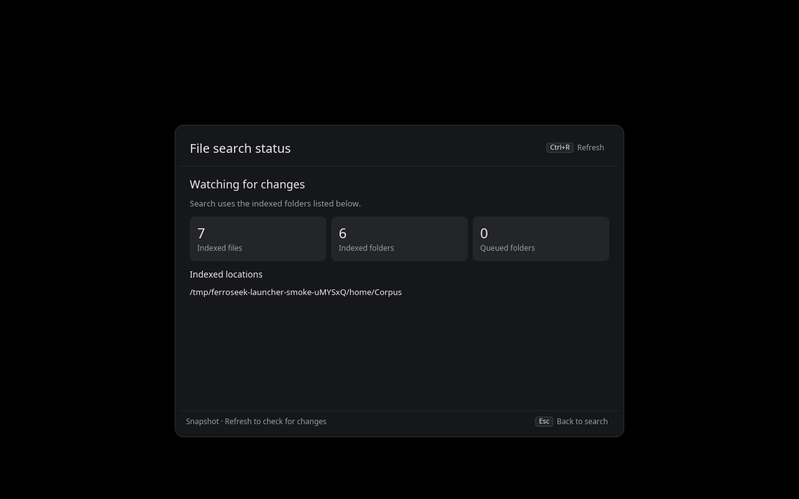

# FerroSeek launcher (`ferroseek-launcher`)

FerroSeek's main user interface is a keyboard-first Linux launcher for
applications, files and calculations on Wayland. It draws a layer-shell overlay, asks the running
`ferroseekd` for file results and launches applications from their
freedesktop desktop entries. It is a separate process: it never opens or
writes the index and adds no background service.

**Status:** experimental. Built and tested in a nested, virtual KWin
(Plasma 6). Other compositors that implement `wlr-layer-shell` should work
but have not been tested. The installer manages the launcher and its search engine with `--launcher`.

## Build and run

Building needs the libxkbcommon development files (`pkg-config xkbcommon`;
`libxkbcommon-dev` on Debian/Ubuntu, `libxkbcommon` on Arch), which a
dependency of the layer-shell backend probes at build time.

```sh
./scripts/install.sh --launcher  # builds and installs launcher + daemon + CLI
ferroseek-launcher            # opens; run it again to close it
```

Bind the command to a key yourself, e.g. in KDE System Settings → Keyboard →
Shortcuts → *Add New* → *Command or Script*. The launcher never registers
global shortcuts or changes desktop settings. Running it while it is open
closes the open instance (single instance via the session-bus name
`io.github.ferroseek.Launcher`).

| Option | Effect |
|---|---|
| `--query TEXT` | start with `TEXT` already typed |
| `--private` | do not record anything opened in this session |
| `--forget-history` | delete the launch history and exit |

The installer preserves configuration and indexes and does not start indexing
unless `--enable` is supplied. Review indexing roots before enabling it.
`./scripts/uninstall.sh --launcher` removes only the launcher and retains
the engine and integrations. See [installation](INSTALLATION.md).

## Keys

| Key | Action |
|---|---|
| Up/Down, Tab/Shift+Tab, Ctrl+N/Ctrl+P | move the selection |
| Ctrl+Up/Ctrl+Down | first row of the previous/next result group; no wrap |
| Page Up/Page Down, Ctrl+Home/Ctrl+End | move by a page, to the first/last row |
| Enter | launch the application, open the file, copy a calculator result |
| Ctrl+Tab / Ctrl+Shift+Tab | Switch between All, Applications and Files |
| Ctrl+1…8 | Run a visible result or filtered action by its displayed number |
| Ctrl+Enter | show the file in its folder, or reuse a calculator result |
| Ctrl+K | open/close the searchable action panel for the selected row |
| Ctrl+I | open/close file search status |
| Ctrl+R | refresh while file search status is open |
| Shift+F10, Menu key | open actions for the selected row |
| Ctrl+Shift+C | copy the file's path |
| Esc | clear the action filter, close actions, clear the query, then close |

Choose **All**, **Applications** or **Files** beside the search field to narrow
results without rewriting the query. Ctrl+Tab cycles forward; Ctrl+Shift+Tab
cycles backward. The choice lasts for this launcher session. Applications mode
makes no file-search requests; Files shows indexed files and recent file
suggestions. Calculator expressions without `=` appear only in All; an explicit
`=` query works in every mode. Switching modes closes actions and resets the
selection; replies from earlier searches are ignored.

Type in the action panel to filter its commands without changing the search
query or selected result. Action search accepts abbreviations such as `copnm`
for **Copy name**, and alternatives such as `reveal` for **Show in folder** or
`continue` for **Use result**. Every query word must match; closer label matches
appear first, and an empty filter restores the original order. Enter runs the
highlighted matching action. Ctrl+1…8
runs the corresponding visible row; numbers follow the window after scrolling
and the matching actions after filtering. The top number-row positions also
work on layouts such as AZERTY, where typing digits normally requires Shift.
Missing numbers do nothing. File
shortcuts remain available while filtering. After copying, the launcher stays
open and returns focus to the main search field. Clicking the main field and
typing closes actions and starts the new search.

The panel shows up to eight actions at a time. Up/Down and the mouse wheel move
the selection; Page Up/Page Down move by a page, and Ctrl+Home/Ctrl+End reach
the first/last action. A range indicator appears for longer menus. Numbers
always refer to the currently visible actions.

Click a result once to select it; double-click or press Enter to open it.
Right-click a result to select it and open its actions, or click **Actions**
in the footer. A click on a result that disappears while results update is
ignored rather than opening a different row. Action clicks also keep the target
and action they were drawn for; changing a filter cannot redirect a queued click
to another command.

## Results

- **Applications** come from `.desktop` files in `$XDG_DATA_HOME` and
  `$XDG_DATA_DIRS`, parsed by the launcher itself (Desktop Entry
  Specification: ID masking, localized names and keywords, `Hidden`,
  `NoDisplay`, `OnlyShowIn`/`NotShowIn`, `TryExec`). Strong name or keyword
  matches are shown above files, weak ones (description only, loose
  subsequence) below them.
  The actions menu also lists the application's declared `.desktop` actions,
  such as **New window** or **New private window**, using their localized names
  and declared order. Search and Enter, a click, or a displayed Ctrl+1…8 shortcut
  runs the chosen action. Only listed actions with a name and a usable `Exec`
  command are shown; actions requiring D-Bus activation without an `Exec`
  fallback are not supported. These commands use argument vectors, the app's
  terminal preference and working directory, and the normal launch scope.
- **Files and folders** come from the daemon's `io.github.ferroseek.Search1.Search`
  method; opening and revealing go through its `Open` method, which only
  opens indexed paths. Calling the daemon's bus name D-Bus-activates it.
- **Calculator:** an arithmetic expression (`(2+3)*4`, `sqrt(2)`, `2^10`)
  shows its value; Enter copies it. Prefix with `=` for calculator-only
  results, including plain numbers (`= 42`), constants (`= pi`) and scientific notation
  (`= 1e-12 * 2`). Ctrl+Enter or **Use result** replaces the expression with
  its answer so you can append another operation. Continued calculations
  retain full precision; copied answers use the displayed precision.
  A fixed grammar is evaluated in process; nothing is passed to a shell or
  interpreter.
- **Empty query:** the most often opened applications and files that still
  exist, followed by available applications to fill the suggestions. Removed
  items do not use up a suggestion slot.
- **No matches:** the query remains visible with a suggestion to refine it;
  Esc clears the search.

Applications start without a shell, from the parsed `Exec` argument vector,
in their own transient systemd user scope when a user manager is available.
`Terminal=true` entries run in `xdg-terminal-exec` or a known terminal.

## Slow or disconnected search services

File search calls wait up to five seconds, and file open/reveal calls up to
fifteen seconds, including service activation. The launcher does not retry
these calls automatically. A timed-out search leaves an error; typing a new
query starts a new search, and replies for older queries remain ignored.

An open request can take effect even if its confirmation is lost. On timeout,
connection loss or an ambiguous service failure, a persistent footer warns
that the open was not confirmed. No launch history is recorded, and further
application/file open actions are blocked for that launcher session to avoid
sending a duplicate. Check the desktop, then close and reopen FerroSeek before
trying again. Search, copy actions, calculations and index status remain usable.
A definite rejection, such as an unindexed path or invalid arguments, allows
an explicit new attempt after the issue is corrected. Only confirmed success
records file usage and closes the launcher.

## File search status

Click **Index status** beside the search filters, or press Ctrl+I, to check the
search service without leaving the launcher. Empty file searches and search
errors also offer **Check file search status**. Esc or **Back to search** returns
to the same query, filter and selected result.



Screenshot from a nested test session with sample files.

The view distinguishes starting, indexing, watching for changes, paused and
stopping states. It shows indexed file/folder counts, queued folders and indexed
locations. Counts describe the index, not the current query's results or a
completion percentage. A folder-watch limit warning indicates that some changes
may not be detected promptly; the error count is cumulative for the service
session and does not mean every reported error is still unresolved.

Opening the view requests a snapshot and can D-Bus-activate the search service.
It does not poll in the background. Use **Refresh** or Ctrl+R for a new snapshot;
only one status request is sent at a time. Up/Down, Page Up/Page Down,
Ctrl+Home/Ctrl+End and the mouse wheel scroll the details. If status cannot be
retrieved, the view shows an error with retry and return controls; missing data
is not displayed as zero. Applications and calculations remain usable.
Status calls time out after three seconds so a stalled diagnostic reply cannot
hold up later file searches or open actions indefinitely. Refresh can retry.

This view does not edit configuration or pause/resume indexing. Folder selection
and first-run configuration in the launcher remain planned. Install or update
the launcher and daemon together to use the status interface.

## Favorites

Use **Add to favorites** or **Remove from favorites** in an app or file's action
panel (search for `pin` or `unpin`). A star marks favorite rows. With an empty
query, favorites appear before recent items, in the order they were added;
the Applications and Files filters still apply. Missing apps or files do not
consume a suggestion slot; their preference is retained if they return.
Favorites do not change the ranking of a typed query.

Favorites are stored separately in
`$XDG_STATE_HOME/ferroseek/launcher-favorites`, with owner-only permissions and
locked, atomic updates. Up to 400 favorites are retained. **Reset ranking** and `--forget-history` leave them
intact. `--private` reads and writes neither saved history nor saved favorites;
any favorites added there last only until that launcher closes. File opening
continues through the daemon, which still requires an indexed path.

## Launch history

`$XDG_STATE_HOME/ferroseek/launcher-usage` (mode `0600`, directory `0700`)
records what was opened and what had been typed, with weights that halve
every 14 days. It is used only to order results:

- Overall use and use from a related query (one is a prefix of the other)
  add a capped boost.
- The boost only reorders matches of the same class: it never lifts a match
  above an exact name, or a weak match above files.
- Updates are a locked read-modify-write, so several instances and
  `--forget-history` do not overwrite each other.

Use **Reset ranking** in an application or file's action panel to remove that
item's overall and query-specific history. Other items keep their history, and
the results update immediately. The application or file remains searchable;
opening it again starts a new history. In a `--private` session, reset changes
only the session's in-memory history. A failed reset is shown in the launcher;
if another instance is updating history, retry after it finishes.

## Design

```text
ferroseek-launcher
 ├─ UI thread: iced (tiny-skia) on a wlr-layer-shell overlay
 │    model.rs (rows, selection, actions, keys) · usage.rs · calc.rs
 └─ bus thread: zbus::block_on for the process lifetime
      ├─ serves io.github.ferroseek.Launcher1.Toggle
      └─ forwards Search/Open to io.github.ferroseek.FerroSeek /io/github/ferroseek/Search
```

- zbus's default runtime drives a connection only from inside
  `zbus::block_on`, so one thread stays in it; the UI talks to it through
  channels. Consecutive pending searches are coalesced; every reply carries
  the query generation and outdated ones are dropped. A new query clears the
  previous file rows, and late results keep the selected row.
- The whole stack is Rust (iced, iced_layershell, zbus, freedesktop-icons);
  it builds no C code. It uses only system protocol libraries:
  libwayland-client and libxkbcommon (the latter must be present at build
  time for `smithay-client-toolkit`'s pkg-config probe). The `.desktop` parser
  is local because the common crate builds C code (gettext).
- `iced_exdevtools` 0.19.1 does not build with `winit-core` beta.4, so
  `winit-core` is pinned to `=0.31.0-beta.2` in the crate manifest.

## Limitations

- No XDG activation token is passed to launched applications:
  `iced_layershell` 0.19 does not expose the layer surface needed to request
  one. Focus of the new window is left to the compositor's policy.
- The window size and position are fixed (720 px wide, near the top of the
  active output); there is no light theme or configuration file yet.

## Tests

```sh
cargo test -p ferroseek-launcher
tests/launcher-smoke.sh target/debug target/launcher-smoke
```

The smoke test runs the launcher on `kwin_wayland --virtual` against a test
`ferroseekd`, with a temporary HOME/XDG tree, a synthetic file corpus and a
private session bus whose activation directory is empty (so neither the
real daemon nor desktop portals can be started). It saves one screenshot per
query and checks that a second invocation closes the first. It skips when
`kwin_wayland` or `spectacle` is missing.
