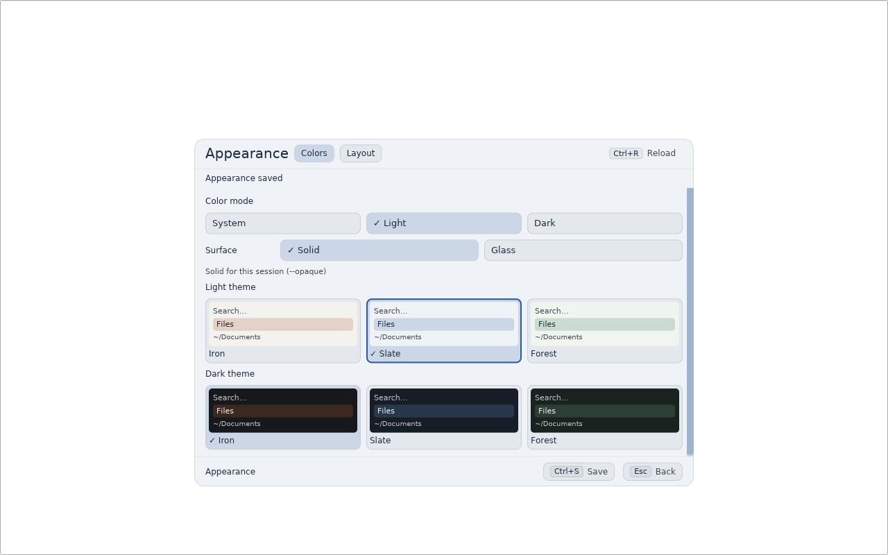
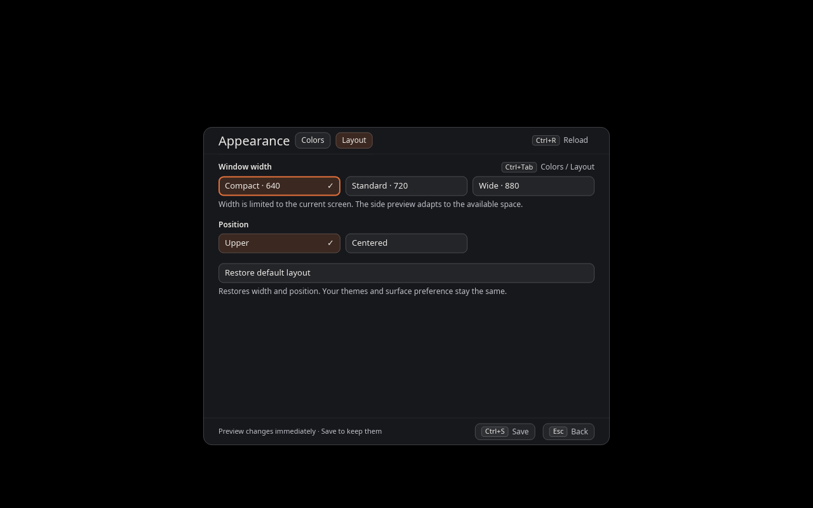
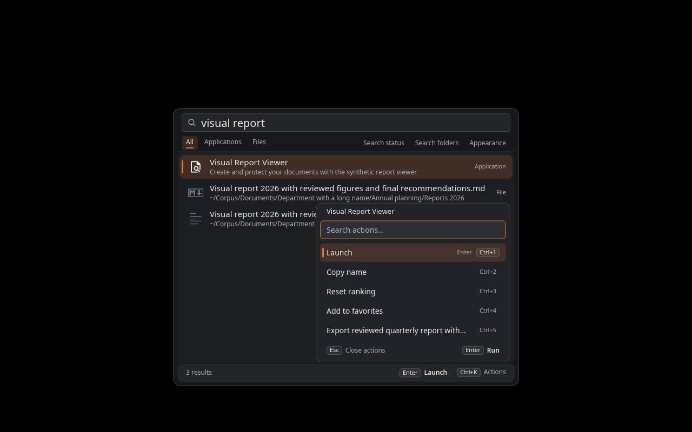
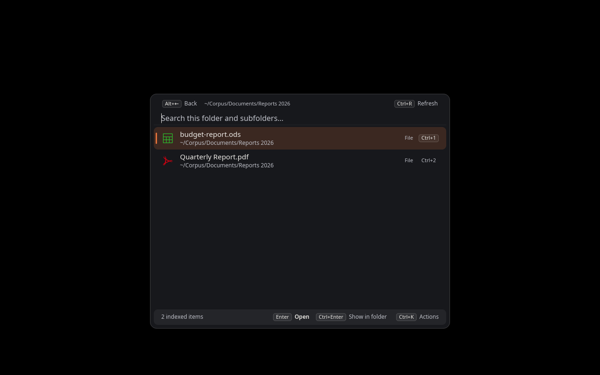
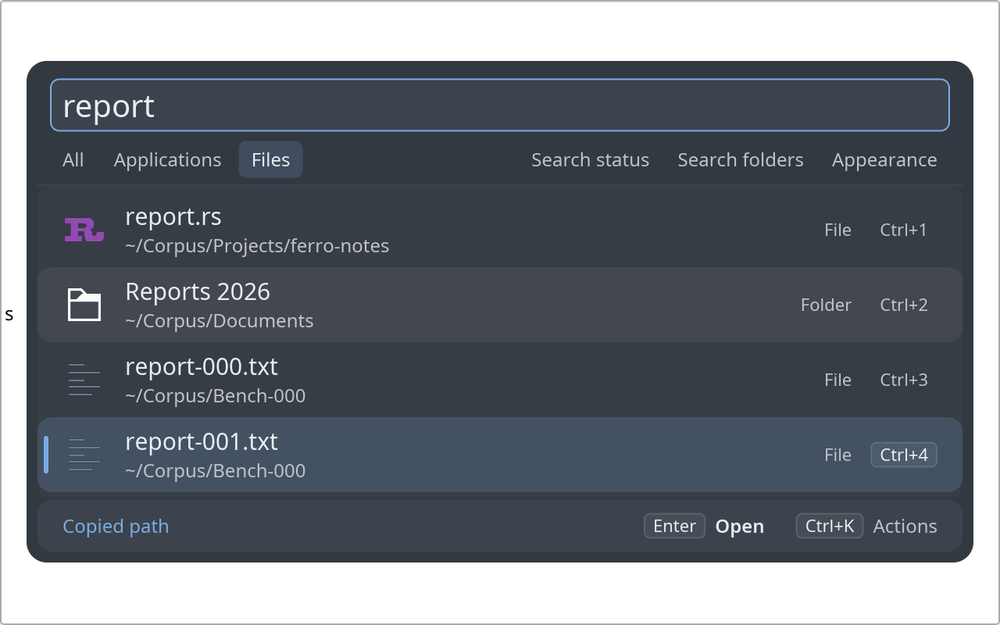

# FerroSeek launcher (`ferroseek-launcher`)

FerroSeek's main user interface is a keyboard-first Linux launcher for
applications, files and calculations on Wayland. It draws a layer-shell overlay, asks the running
`ferroseekd` for file results and launches applications from their
freedesktop desktop entries. It is a separate process: it never opens or
writes the index and adds no background service.

**Status:** experimental. Automated graphical checks run in nested virtual KWin
5.27.11 on Ubuntu 24.04. Other desktop sessions remain unverified; see the
[validation matrix](#desktop-validation). The installer manages the launcher and
its search engine with `--launcher`.

## Build and run

Building needs the libxkbcommon development files (`pkg-config xkbcommon`;
`libxkbcommon-dev` on Debian/Ubuntu, `libxkbcommon` on Arch), which a
dependency of the layer-shell backend probes at build time.

```sh
./scripts/install.sh --launcher  # builds and installs launcher + daemon + CLI
ferroseek-launcher            # opens; run it again to close it
```

Bind the command to a key yourself, e.g. in KDE System Settings → Keyboard →
Shortcuts → *Add New* → *Command or Script*. The launcher never registers
global shortcuts or changes desktop settings. Running it while it is open
closes the open instance (single instance via the session-bus name
`io.github.ferroseek.Launcher`). It also closes when another window takes keyboard
focus, for example after a click outside it, except while an open is in progress,
while the folder or appearance settings screen is shown, or after a copy in this session: the
launcher serves the copied value, so it stays until Esc or the toggle closes it.

| Option | Effect |
|---|---|
| `--query TEXT` | start with `TEXT` already typed |
| `--private` | do not record anything opened in this session |
| `--opaque` | use a solid surface without background blur |
| `--forget-history` | delete the launch history and exit |

The installer preserves configuration and indexes and does not start indexing
unless `--enable` is supplied. Review indexing roots before enabling it.
`./scripts/uninstall.sh --launcher` removes only the launcher and retains
the engine and integrations. See [installation](INSTALLATION.md).

## Appearance



[Dark appearance](assets/launcher-appearance-dark.png). Native presentation
captures from isolated virtual KWin 6.3.6 at 1×, using Compact, Iron and Solid
with the tiny-skia renderer and synthetic data. The refreshed search, folder
browser, action panel, application chooser and text-preview images use the same setup. These captures do not extend
the desktop, fractional-scale or blur validation matrix below.

Choose **Appearance** in the search header, or press **Ctrl+Shift+Comma**.
**System**, **Light** and **Dark** control the color mode. Choose an independent
**Iron**, **Slate** or **Forest** theme for light and dark mode; the miniatures
show search, selection and secondary text with the same semantic colors as the
launcher, including its accent selection bar. A check on the right marks the
selected choice without shifting its name; an accent outline marks keyboard
focus, while pointer hover uses a neutral border. Section labels and spacing
group related choices; the footer explains live preview and saving unless
unsaved changes need attention. Up/Down or Tab/Shift+Tab move
between choices, and Enter selects one.
Lower choices scroll into view. **Colors** and **Layout** are tabs; Ctrl+Tab
or Ctrl+Shift+Tab switches between them. Ctrl+S saves; Esc returns to search. Unsaved
changes require explicit discard (Ctrl+D); Esc keeps editing at that prompt.
Ctrl+R reloads saved preferences when there are no unsaved edits. Search state
and in-flight results are retained while editing.

Changes preview immediately. **Save** writes only `[appearance]` in the existing
configuration, preserving other settings and comments. Atomic private writes
refuse a stale snapshot or symbolic-link file. Errors retain the draft. These
launcher preferences need no service restart and are saved in private mode too;
private mode only disables history and favorites. Older FerroSeek versions
reject this new section; remove `[appearance]` before downgrading.

```toml
[appearance]
mode = "system"       # system, light, dark
material = "glass"    # glass, solid
light_theme = "iron"  # iron, slate, forest
dark_theme = "iron"
width = "standard"   # compact (640), standard (720), wide (880) logical px
position = "upper"   # upper, centered
```



[Centered layout](assets/launcher-layout-centered.png). Native Compact layout
captures from the same isolated KWin setup: upper and centered on 1280×800,
both at an observed 1× scale.

**Layout** offers Compact (640), Standard (720) and Wide (880) widths and upper
or centered placement. The default remains Standard and Upper. The side preview
adds 260 logical pixels when space permits. Width is capped to the entered
output minus 16 pixels on each side; short outputs show fewer result/action rows
and the header uses a third row below 512 pixels. The search field has its own
full-width row and the same focus outline as the other editable fields. Upper
placement stays stable as results expand; centering follows the current surface height. **Restore default layout**
previews Standard and Upper without changing themes or material. Save keeps the
reset; Back and discard restore the last saved settings.

Automatic bounds require the compositor's XDG output and subsurface interfaces.
Without them the requested preset still applies, with final sizing controlled
by the compositor. The bounds describe the logical output, not a panel-free
work area. No desktop configuration is changed. Mixed-scale virtual output
changes are checked in isolated KWin; physical desktops and cable hotplug remain
unverified. Versions predating these controls reject
`width` and `position`; remove those keys before downgrading.

System follows the read-only XDG Settings portal's color preference and change
notifications, including service replacement. No preference, unknown values or
an unavailable portal use Dark. Reads do not block the first frame. Explicit
Light/Dark ignores the desktop preference. The portal API is documented in the
[official Settings specification](https://flatpak.github.io/xdg-desktop-portal/docs/doc-org.freedesktop.portal.Settings.html).

**Solid** and **Glass** are independent of the color theme. Glass becomes
translucent when the compositor advertises background blur and the renderer
supports transparency. Rounded blur regions follow normal, compact and preview
layouts; action menus stay solid. If blur is unavailable or withdrawn, the
surface is opaque. `--opaque` overrides the saved material for that session;
it does not change the preference. No desktop effects or settings are changed.

The launcher uses `ext-background-effect-v1`, or the older KDE blur extension
when the standard manager is absent. The compositor controls the blur algorithm;
an advertised interface is not a guarantee that an effect is visually applied.
WGPU presents the transparent surface and requires a working graphics driver
(e.g. Mesa Vulkan on Linux). If adapter initialization fails, iced falls back to
tiny-skia with a solid material. `ICED_BACKEND=tiny-skia ferroseek-launcher` selects
that software path explicitly. `--opaque` keeps the normal renderer and disables
blur; it does not select a driver.

The rendered blur is checked in virtual KWin with Mesa software graphics;
physical desktops and hardware GPU drivers remain unverified. WGPU adapter and
pipeline initialization can change startup time and memory use; previous timing
tables describe the earlier software path.

[Blurred surface](assets/launcher-glass.png) · [Opaque surface](assets/launcher-opaque.png)

These captures use a fine-striped backdrop in an isolated KWin session.

## Keys

| Key | Action |
|---|---|
| Up/Down, Tab/Shift+Tab, Ctrl+N/Ctrl+P | move the selection |
| Ctrl+Up/Ctrl+Down | first row of the previous/next result group; no wrap |
| Page Up/Page Down, Ctrl+Home/Ctrl+End | move by a page, to the first/last row |
| Enter | launch the application, open the file, copy a calculator result |
| Ctrl+Tab / Ctrl+Shift+Tab | Switch between All, Applications and Files |
| Ctrl+1…8 | Run a visible result or filtered action by its displayed number |
| Ctrl+Enter | show the file in its folder, or reuse a calculator result |
| Alt+Right / Alt+Left | Browse the selected folder / return to the previous context |
| Ctrl+K | open/close the searchable action panel for the selected row |
| Ctrl+I | open/close file search status |
| Ctrl+Shift+Comma | appearance preferences |
| Ctrl+R | refresh while file search status is open |
| Shift+F10, Menu key | open actions for the selected row |
| Ctrl+Shift+C | copy the file's path |
| Esc | clear the action filter, close actions, clear the query, return from folder search, then close |

**Copy path** and Ctrl+Shift+C copy a lossless file URL when the selected file
or folder's path contains non-UTF-8 bytes. Other paths are copied as plain text.

Choose **All**, **Applications** or **Files** below the search field to narrow
results without rewriting the query. An accent underline marks the active filter
alongside its background highlight. Ctrl+Tab cycles forward; Ctrl+Shift+Tab
cycles backward. The choice lasts for this launcher session. Applications mode
makes no file-search requests; Files shows indexed files and recent file
suggestions. Calculator expressions without `=` appear only in All; an explicit
`=` query works in every mode. Switching modes closes actions and resets the
selection; replies from earlier searches are ignored.

Type in the action panel to filter its commands without changing the search
query or selected result. Action search accepts abbreviations such as `copnm`
for **Copy name**, and alternatives such as `reveal` for **Show in folder** or
`continue` for **Use result**. Every query word must match; closer label matches
appear first, and an empty filter restores the original order. Enter runs the
highlighted matching action. Ctrl+1…8
runs the corresponding visible row; numbers follow the window after scrolling
and the matching actions after filtering. The top number-row positions also
work on layouts such as AZERTY, where typing digits normally requires Shift.
Missing numbers do nothing. File
shortcuts remain available while filtering. After copying, the launcher stays
open and returns focus to the main search field. Clicking the main field and
typing closes actions and starts the new search.

The panel shows up to eight actions at a time, with fewer on short outputs to
leave room for its target, search field and return hint. Up/Down and the mouse wheel move
the selection; Page Up/Page Down move by a page, and Ctrl+Home/Ctrl+End reach
the first/last action. A range indicator appears for longer menus. Numbers
always refer to the currently visible actions.
Scrolling over the action panel affects only its actions, including while a
text preview is open. Horizontal scrolling leaves the selection unchanged.
The target name above the filter uses primary text. Pointer hover highlights a
command without moving the keyboard selection. The footer shows Enter to run
the selected matching action alongside the current Escape step. With no matches,
it suggests another action name and omits the Enter hint.



Typing can follow Ctrl+K, Escape or a context click immediately. The launcher
applies the command and focuses the current field before delivering later input
from the same event batch. Native text editing, selection and clipboard handling
stay in the text widget. A delayed focus request for a departed field is ignored;
focus loss discards deferred input before the next activation. `--query` is
applied before the first input field is built.

This applies to input received by the launcher. Before the compositor gives it
keyboard focus, keystrokes still belong to the previously focused application.

Click a result once to select it; double-click or press Enter to open it.
Hover highlights the pointed row without moving the keyboard selection.
Highlights are inset from the row edges; the surrounding padding stays clickable.
Right-click a result to select it and open its actions, or click **Actions**
in the footer. A click on a result that disappears while results update is
ignored rather than opening a different row. Action clicks also keep the target
and action they were drawn for; changing a filter cannot redirect a queued click
to another command.

## Results

Numbered shortcuts stay visible on every result and application choice. The
selected row keeps its keycap; other rows use quieter text with the same spacing.
The action panel uses the same numbering treatment and an accent bar for its
highlighted command. Footer shortcuts keep their keycaps. The Enter action uses
stronger text in the result and application-chooser footers. Result types appear
as plain secondary labels, except beside the preview, where names and paths use
that space. Paths and numbered shortcuts remain visible in both layouts.
Names and paths shorten to fit the available column, including beside the text
preview. Action labels and target titles also shorten to keep shortcuts visible.
File names keep both ends so their extension remains visible; application
names, application descriptions and calculator expressions shorten at the end.
File names retain a whole final word where space permits, including the
extension. Path labels prioritize the final component and shorten ancestors;
component boundaries are used when they retain most of the available text. Result paths, folder headers, settings, search status, the application
chooser and the preview abbreviate the home directory as `~`. Direct folder
children omit the repeated parent path; recursive results show a relative parent.
Header and preview path tooltips retain the absolute location; copying a path still uses the absolute
path or lossless file URL. File details retain the full location.
Empty file-search states separate the existing recovery actions from the help
text with more spacing and stronger text: accent on opaque surfaces, primary
text on translucent surfaces to preserve contrast over bright backgrounds.

- **Applications** come from `.desktop` files in `$XDG_DATA_HOME` and
  `$XDG_DATA_DIRS`, parsed by the launcher itself (Desktop Entry
  Specification: ID masking, localized names and keywords, `Hidden`,
  `NoDisplay`, `OnlyShowIn`/`NotShowIn`, `TryExec`). Strong name or keyword
  matches are shown above files, weak ones (description only, loose
  subsequence) below them.
  The actions menu also lists the application's declared `.desktop` actions,
  such as **New window** or **New private window**, using their localized names
  and declared order. Search and Enter, a click, or a displayed Ctrl+1…8 shortcut
  runs the chosen action. Only listed actions with a name and a usable `Exec`
  command are shown; actions requiring D-Bus activation without an `Exec`
  fallback are not supported. These commands use argument vectors, the app's
  terminal preference and working directory, and the normal launch scope.
- **Files and folders** come from the daemon's `io.github.ferroseek.Search1.Search`
  method; opening and revealing go through its `Open` method, which only
  opens indexed paths. Calling the daemon's bus name D-Bus-activates it.
- **Calculator:** an arithmetic expression (`(2+3)*4`, `sqrt(2)`, `2^10`)
  shows its value; Enter copies it. Prefix with `=` for calculator-only
  results, including plain numbers (`= 42`), constants (`= pi`) and scientific notation
  (`= 1e-12 * 2`). Ctrl+Enter or **Use result** replaces the expression with
  its answer so you can append another operation. Continued calculations
  retain full precision; copied answers use the displayed precision.
  A fixed grammar is evaluated in process; nothing is passed to a shell or
  interpreter.
- **Empty query:** the most often opened applications and files that still
  exist, followed by available applications to fill the suggestions. Removed
  items do not use up a suggestion slot.
- **No matches:** the query remains visible with a suggestion to refine it;
  Esc clears the search.

Applications start without a shell, from the parsed `Exec` argument vector,
in their own transient systemd user scope when a user manager is available.
`Terminal=true` entries run in `xdg-terminal-exec` or a known terminal.
When an entry specifies `Path`, launching requires that working directory to
be accessible. Restore it or correct the entry before retrying a failed launch.

## Application activation

Opening an application, a declared action or an indexed file, choosing **Open
with…**, and showing a file in its folder request fresh Wayland activation
context from the launcher's focused surface and current input. The footer shows
**Opening application…** for apps and **Opening…** for files. The chosen target,
action or handler and original query stay captured during asynchronous work;
further open commands are ignored until submission completes.

Token acquisition waits at most one second. File actions request it when the
bus worker is ready to dispatch, after earlier queued work, without guessing the
desktop-selected target's application ID. If context is unavailable or acquisition
fails, the ordinary open is sent once without it. Desktop child processes remove
inherited `XDG_ACTIVATION_TOKEN` and `DESKTOP_STARTUP_ID`, then supply only this
operation's nonempty token. Token values and key contents are not logged.

Reveal forwards the context through `FileManager1.ShowItems`' startup-ID argument
and its existing parent-directory fallback. Support for XDG tokens through that
older interface depends on the receiving file manager. The application and
compositor choose whether to create a window, raise an existing instance or
decline focus; FerroSeek does not choose a particular application window.
History is recorded only after successful submission acknowledgement, which does
not prove focus. Known submission failures leave the launcher usable for retry;
uncertain replies retain the duplicate-open protection described below.

Esc retains its normal clear-query/close sequence. Closing with Esc or the
instance toggle cancels deferred tasks. A queued file action checks cancellation
before requesting context and again before D-Bus dispatch. An already submitted
operation may still open; closing cannot undo it.

The adapter uses an independent queue on iced's shared Wayland connection;
it needs no window-manager permissions or desktop configuration changes. See
[the architecture](ARCHITECTURE.md#launcher-and-engine-boundaries). Virtual KWin
checks use synthetic applications and assert real keyboard input in the chosen
window. Physical desktops, other compositors, multiple seats and target toolkits
remain to be validated.

## Slow or disconnected search services

File search calls wait up to five seconds, and file open/reveal/Open with calls
wait up to fifteen seconds after dispatch, including service activation. The
activation-context wait and earlier queued work are additional. The launcher does not retry
these calls automatically. A timed-out search leaves an error; typing a new
query starts a new search, and replies for older queries remain ignored.

An open request can take effect even if its confirmation is lost. On timeout,
connection loss or an ambiguous service failure, a persistent footer warns
that the open was not confirmed. No launch history is recorded, and further
application/file open actions are blocked for that launcher session to avoid
sending a duplicate. Check the desktop, then close and reopen FerroSeek before
trying again. Search, copy actions, calculations and index status remain usable.
A definite rejection, such as an unindexed path or invalid arguments, allows
an explicit new attempt after the issue is corrected. Only confirmed success
records file usage and closes the launcher.

## File search status

Click **Search status** to the right of the search filters, or press Ctrl+I, to check the
search service without leaving the launcher. Empty file searches and search
errors also offer **Check search status**. Esc or **Back to search** returns
to the same query, filter and selected result.


Screenshot from a nested test session with sample files.

The view distinguishes starting, indexing, watching for changes, paused and
stopping states. It shows indexed file/folder counts, queued folders and indexed
locations. Counts describe the index, not the current query's results or a
completion percentage. A folder-watch limit warning indicates that some changes
may not be detected promptly; the error count is cumulative for the service
session and does not mean every reported error is still unresolved.

Opening the view requests a snapshot and can D-Bus-activate the search service.
It does not poll in the background. Use **Refresh** or Ctrl+R for a new snapshot;
only one status request is sent at a time. Up/Down, Page Up/Page Down,
Ctrl+Home/Ctrl+End and the mouse wheel scroll the details. If status cannot be
retrieved, the view shows an error with retry and return controls; missing data
is not displayed as zero. Applications and calculations remain usable.
Status calls time out after three seconds so a stalled diagnostic reply cannot
hold up later file searches or open actions indefinitely. Refresh can retry.

This view does not edit configuration or pause/resume indexing. Use **Search folders**
or Ctrl+, to choose search locations. Install or update the launcher and daemon
together to use the status and folder interfaces.

## Search folders and initial setup


Screenshot from a nested test session with sample folders.

If the configuration file is missing, the launcher opens **Search folders** before
sending any file queries, including a `--query` prefill. Review the default home
folder, add or remove folders, then use **Save & apply** (Ctrl+S). Choosing no
folders disables file indexing. Esc closes an unsaved first-run screen without
creating a configuration or starting the service. CLI and explicitly enabled
services retain their existing configuration/default behavior.

Later, open **Search folders** in the search header or press Ctrl+,. Empty file results
also offer **Choose folders**. Type an absolute path or `~/Documents` and press
Enter to add it; use Up/Down to select a folder and Ctrl+D or **Remove** to remove
it. New folders must exist, be readable directories and not be symbolic links;
existing offline locations can be retained. Adding a folder inside or around a
listed one says which folder already covers it. A selected folder shows its full location below its label only when that label
is shortened. Page Up/Down, Ctrl+Home/End and the wheel scroll the details.
One line summarizes what indexing skips (from the running service, otherwise the
saved file) and names the configuration file to edit; a warning appears when the
service uses a different file. Viewing this screen does not activate the service.

Saving changes only `roots` in the TOML file and preserves other settings and
surrounding comments. Writes use a locked, atomic replacement with private file
permissions. A stale file snapshot is refused; **Reload** (Ctrl+R) reloads disk
settings after confirming discard of unsaved edits. Esc keeps editing when a
discard prompt is visible; Ctrl+D explicitly discards. Invalid or symlinked
configuration files are not overwritten. Symlink targets must be edited separately.

**Save & apply** explicitly starts the service if necessary, then applies the
saved folders without a restart. Removing a location removes its indexed entries
and watches, never user files. Indexing continues in the background and a paused
service stays paused. Other saved settings are not applied to an already running
service; a message reports if they still need a service restart. A service using a
different configuration file refuses the application. Errors preserve the draft;
if saving succeeded but application could not be confirmed, settings remain saved
and Ctrl+S can safely retry. Applying times out after 30 seconds; older daemons
without this method must be updated. The screen cannot close during saving or
application; after a failure, Esc returns to search and refreshes its file results.

## Browse and search folders



Rendered in a private virtual KWin session with a synthetic indexed tree.

Select a folder result and press **Alt+Right**, or choose **Browse folder** from
Actions (Ctrl+K; `within` and `search in folder` remain aliases). The header shows
the captured location. An empty search field immediately lists indexed direct
children, with folders first and then case-folded name/raw-name order. History
does not reorder this listing. Symbolic links and special entries are omitted.
Enter keeps its normal action of opening the selected item in its application;
use Alt+Right again to browse a selected child folder.

A listing contains at most 200 entries. **First 200 indexed items · Type to search**
means the list was limited. Type at least two characters to use the existing
ranked search throughout the folder and its subfolders, including items outside
the initial listing. One character shows a minimum-length prompt. Clearing the
query returns to direct children. Query syntax and result limits for recursive
search match normal file search. An empty listing means no supported children
are currently indexed, not a guarantee that the filesystem folder is empty.


Folder URLs stay separate from query syntax, including spaces and non-UTF-8
bytes. Listings read the index, without enumerating filesystem directories or
changing the index. The indexed folder must still be a regular directory with
the recorded inode. Invalid, unavailable, replaced, unindexed and symbolic-link
folders are refused without broadening the scope. Index freshness and configured
coverage apply to both browsing and searching.

**Refresh** or Ctrl+R in a folder context reloads its listing/search while keeping
the selected target if it remains available. An enabled preview reloads for the
resulting selected file; its own Refresh button can reload only that preview.
Loading, empty-indexed-folder, short-query and unavailable states are distinct.

**Alt+Left** or the header's **Back** button restores the previous query, result
filter, folder, list and selected target when still available, then refreshes that
snapshot. Esc clears the action filter/menu, hides an enabled preview, then clears
the query, then returns to the previous context. Return history is bounded to the
current launcher session. Late replies from previous lists or searches cannot
replace the current context.

Folder contexts contain no global suggestions, apps or calculator results.
The All/Applications/Files filter is unavailable until returning to global search.
Open with, File details and the opt-in preview remain available for regular files.
Browsing does not enable preview or read file contents; an already enabled preview
follows the selected regular file. Ctrl+I opens index status; Ctrl+comma opens
folder settings. Applying folder settings returns to global search with the
original query. Navigation and refresh do not record launch history. Matching
launcher and daemon versions are required.

## Open with a selected application


Native Compact capture in a private virtual KWin 6.3.6 session at 1× with
synthetic document handlers and the tiny-skia renderer. Names, desktop IDs and
the target path shorten to their actual available width, leaving room for
numbered shortcuts. Hover over the target path to see its absolute location.
This presentation check does not extend the desktop
validation matrix below.

For a file result, open **Actions** (Ctrl+K), search for **Open with…** and press
Enter. Choose an application with Up/Down and Enter, a displayed Ctrl+number,
or a click. Typing filters application names and desktop IDs; the ID beneath
its name helps distinguish similarly named apps. Page Up/Down, Ctrl+Home/End
and the mouse wheel navigate longer lists.
Use **Refresh** or Ctrl+R to rescan the available applications.
The footer shows the application count, the visible range for longer lists, or
the current loading/opening/error status on the left, with Enter and the contextual Esc action on the right.

The chooser stays bound to the original file while results finish loading.
Esc clears a nonempty application filter; Esc again returns to the same search
query, scope and file selection when that file is still present. Ctrl+R reloads
the application list, retaining the selected application if it is still present,
including after a failed read and retry. Editing or clearing the filter resets
the selection even while a reload is pending. Loading, empty and error states
are distinct; a failed read can be retried. The list is requested only when
opening or reloading this view, rather than on each filter keystroke.

Choosing an application is a one-time action. It does not change MIME defaults
or save a preferred application. The daemon checks that the file is still
indexed and available and that the chosen desktop ID is still eligible before
launching it. Failures keep the chooser available; a launch with an uncertain
reply uses the same duplicate-open protection as normal file opening. History
is recorded only after daemon acknowledgement.

Compatibility: this first version lists installed desktop entries declaring the
file's detected MIME type, an alias or a parent type and accepting one `%f`,
`%F`, `%u` or `%U` document field. Single-file `%f`/`%u` can also appear within
an option argument; list fields `%F`/`%U` must stand alone. It includes `NoDisplay` document handlers,
honours hidden-entry masks, visibility and `TryExec`, and never accepts a caller-supplied command. Type
detection uses filename metadata from shared-mime-info and does not read file
contents. Unrecognized types, folders and symbolic links are not supported by
the chooser; normal **Open** remains available. Desktop association preference
overrides and applications with only D-Bus activation are not included. Install
matching launcher and daemon versions for this interface.

## File details


Rendered in a private virtual KWin session with a synthetic file.

For an indexed regular file, open **Actions** (Ctrl+K), search for **File details**
or `properties`, and press Enter. The view shows the full name and location,
detected MIME type, current size and last modification time in UTC. Sizes include
an exact byte count. An unknown type is shown explicitly.

The daemon reads filesystem attributes on request, including while indexing is
paused; it does not read file contents. Ctrl+R refreshes the details. Loading and
errors have distinct states, and failed reads can be retried. Late replies cannot
replace a newer view or change the captured file. Esc returns to the original
query, scope and selected file if it remains in the results. Up/Down, Page Up/Down
and Ctrl+Home/End scroll long details.

Use **Copy path** or Ctrl+Shift+C to copy the captured location. For a path that
cannot be represented as UTF-8 text, the view shows and copies its lossless file
URL instead. Viewing, refreshing and copying details do not record launch history.
Folders and symbolic links are not supported by this view. Matching launcher and
daemon versions are required.

## Text preview


Rendered in a private virtual KWin session with a synthetic file.

Choose **Preview text** from a regular file's Actions menu (Ctrl+K; search for
`preview` or `contents`), or press Enter in **File details**. It enables a sidebar
beside the results, with text and current type, size and modification time. File
details closes back to results when enabling the sidebar.

No content is read merely by opening the launcher or selecting results while
preview is disabled. Once enabled, the sidebar follows the selected regular file:
navigation, search editing and result-filter changes can start a new content and
metadata read. A new query clears the old text immediately. Applications, folders
and empty results show a prompt without reading content. Late responses cannot
replace the current target. A stable selected target does not reread just because
results were reordered.

**Hide** or Esc closes the sidebar before clearing the search; it preserves the
current query, filter and selection and stops reads on subsequent navigation.
Preview stays enabled only for the current launcher session. Modal screens such as
index status, folder and appearance settings, File details and Open with hide the sidebar and
pause new preview reads. Returning resumes it for the current selected file.
Opening, refreshing or copying a preview does not record launch history.

The view displays plain text, including Markdown or HTML source without rendering
or executing it. Supported MIME types are `text/*`, JSON, XML, JavaScript, TOML and
YAML, determined by the system MIME filename database. Unknown types, binary
control characters (including terminal ESC sequences, DEL and C1) and invalid UTF-8
in the inspected prefix have a distinct
unsupported state. Empty files are identified explicitly. PDF, images and other
rich previews are not available. Glyph coverage depends on installed desktop fonts.

Reads inspect at most 64 KiB plus one truncation-detection byte. Display is limited
to 16,384 Unicode characters and 200 logical lines, whichever limit is reached
first; a clipped preview says **Beginning of file**. An incomplete UTF-8 sequence
at the byte boundary is omitted. CRLF, CR and form-feed page breaks display as LF. These
limits apply before visual wrapping; the remainder of the file is not validated.

Up/Down, Page Up/Down and Ctrl+Home/End navigate the **results**. Use
**Alt+Page Up/Down** to scroll the preview text, or the wheel over its text area.
Scrolling the preview does not change the selected result; the wheel over the
result list navigates that list. **Refresh** (Ctrl+R) retries content and metadata
for the selected file and returns its text to the top. A metadata failure does
not discard successfully loaded text.

The sidebar's **Copy path**, or Ctrl+Shift+C outside Actions, copies its location;
when the path contains non-UTF-8 bytes it copies the lossless file URL. The name
and parent folder are shown separately; hover over the folder to see the complete
file location. The preview has no editor or content-copy
command. Enter and the normal file actions remain available with the sidebar open;
only a confirmed open records launch history.

Only indexed regular files are accepted. Symbolic links in any path component,
changed file identities and unavailable paths are refused. After atomic file
replacement, wait for indexing to catch up before refreshing. A file changed during
the read is refused when detected. Reads use a pinned descriptor through Linux
`/proc/self/fd`, never re-open the supplied path after validation. The launcher
shows a timeout after three seconds; underlying filesystem work may still finish
in the daemon. Matching launcher and daemon versions are required. File text is
neither indexed nor persisted by this feature.

## Favorites

Use **Add to favorites** or **Remove from favorites** in an app or file's action
panel (search for `pin` or `unpin`). A star marks favorite rows. With an empty
query, favorites appear before recent items, in the order they were added;
the Applications and Files filters still apply. Missing apps or files do not
consume a suggestion slot; their preference is retained if they return.
Favorites do not change the ranking of a typed query.

Favorites are stored separately in
`$XDG_STATE_HOME/ferroseek/launcher-favorites`, with owner-only permissions and
locked, atomic updates. Up to 400 favorites are retained. **Reset ranking** and `--forget-history` leave them
intact. `--private` reads and writes neither saved history nor saved favorites;
any favorites added there last only until that launcher closes. File opening
continues through the daemon, which still requires an indexed path.

## Launch history

`$XDG_STATE_HOME/ferroseek/launcher-usage` (mode `0600`, directory `0700`)
records what was opened and what had been typed, with weights that halve
every 14 days. It is used only to order results:

- Overall use and use from a related query (one is a prefix of the other)
  add a capped boost.
- The boost only reorders matches of the same class: it never lifts a match
  above an exact name, or a weak match above files.
- Updates are a locked read-modify-write, so several instances and
  `--forget-history` do not overwrite each other.

Use **Reset ranking** in an application or file's action panel to remove that
item's overall and query-specific history. Other items keep their history, and
the results update immediately. The application or file remains searchable;
opening it again starts a new history. In a `--private` session, reset changes
only the session's in-memory history. A failed reset is shown in the launcher;
if another instance is updating history, retry after it finishes.

## Design

The [design guide](../DESIGN.md) defines visual language, shared styling,
interaction rules and the review checklist for UI changes. The architecture
below describes how the launcher implements those workflows.

```text
ferroseek-launcher
 ├─ UI thread: iced (WGPU; tiny-skia fallback) on a wlr-layer-shell overlay
 │    model.rs (rows, selection, actions, keys) · usage.rs · calc.rs
 └─ bus thread: zbus::block_on for the process lifetime
      ├─ serves io.github.ferroseek.Launcher1.Toggle
      └─ forwards Search/Open to io.github.ferroseek.FerroSeek /io/github/ferroseek/Search
```

- zbus's default runtime drives a connection only from inside
  `zbus::block_on`, so one thread stays in it; the UI talks to it through
  channels. Consecutive pending searches are coalesced; every reply carries
  the query generation and outdated ones are dropped. A new query clears the
  previous file rows, and late results keep the selected row.
- In `ui.rs`, runtime observations precede appearance routing and the shared
  modal-input guard. Query changes, file replies, open completions and view
  refreshes have separate handlers. Background replies still pass through
  while appearance is open; refactoring this order must preserve generation
  checks, captured targets and the preview/focus synchronization around updates.
- The whole stack is Rust (iced, iced_layershell, zbus, freedesktop-icons);
  it builds no C code. It uses only system protocol libraries:
  libwayland-client and libxkbcommon (the latter must be present at build
  time for `smithay-client-toolkit`'s pkg-config probe). The `.desktop` parser
  is local because the common crate builds C code (gettext).
- `iced_exdevtools` 0.19.1 does not build with `winit-core` beta.4, so
  `winit-core` is pinned to `=0.31.0-beta.2` in the crate manifest.

## Limitations

- Focus depends on the receiving application and compositor; activation context
  may be unavailable or declined. Application entries still need a usable `Exec`;
  D-Bus-only entries and explicit application-window switching are unsupported.
- Closing on outside clicks needs the compositor to move keyboard focus away from
  an exclusive overlay. Virtual KWin does; compositors that keep it stay open until Esc.
- The default width is 720 logical px, or 980 with the preview sidebar.
  Appearance → Layout changes width and placement; output bounds can reduce
  the effective width and row count. Mixed-scale virtual output changes are
  checked in isolated KWin; physical desktops and cable hotplug remain unverified.

## Tests

```sh
cargo test -p ferroseek-launcher
tests/launcher-smoke.sh target/debug target/launcher-smoke
```

The smoke test runs the launcher on `kwin_wayland --virtual` against a test
`ferroseekd`, with a temporary HOME/XDG tree, a synthetic file corpus and a
private session bus whose activation directory is empty (so neither the
real daemon nor desktop portals can be started). It saves one screenshot per
query and checks that a second invocation closes the first. It skips when
`kwin_wayland` or `spectacle` is missing in screenshot-only mode. Interaction
mode treats missing graphical prerequisites or non-OpenGL compositing as
inconclusive and exits with status 77.

For real keyboard input and focus checks in the disposable compositor:

```sh
FERROSEEK_SMOKE_INTERACTION=1 tests/launcher-smoke.sh target/release target/launcher-interaction
```

The same harness accepts `FERROSEEK_SMOKE_PROFILE=us-layout-1x` (640×480)
and `us-layout-1.5x` (960×640 logical, 1440×960 native). These run functional
layout cases instead of latency trials: three width presets, upper/centered
placement measured from native screenshots, live reset/discard, save/restart,
side preview and typing after returning to results, in all three renderer modes.
A separate `us-short-1x` (640×332) case exercises Page Up/Down and numbered
application dispatch when the chooser fits one row; each page still moves at
least one application. The existing US/AZERTY/1.5× latency workloads are unchanged.
See `layout.json`
and the companion native captures in the workflow artifacts. These checks cover
single virtual outputs; hotplug, output switching and physical panels remain open.

Set `FERROSEEK_SMOKE_MODE=auto`, `opaque` or `software` to measure the default
appearance, `--opaque` or forced tiny-skia. `all` rotates all three within the
same compositor and daemon. `FERROSEEK_SMOKE_TRIALS` is the number of opens per
mode, so the default 20 gives 60 measured opens with `all`. Unknown modes fail
before any private bus or service starts. Each launch clears inherited
`ICED_BACKEND` before applying its mode; other recorded graphics settings remain.
Interaction output directories must be new or empty so old logs and readiness
markers cannot satisfy a new run's checks.
Application and document activation checks use the selected mode, or `auto`
with `all`. The separate material controls always exercise their three modes.

This mode also requires Python 3 with PyQt5 and GTK 4 introspection bindings,
a C compiler, `wayland-scanner`,
Wayland client headers, `plasma-wayland-protocols`, Breeze/Hicolor icon themes
and shared MIME data. Its test-only input client
refuses sockets outside the isolated smoke-test namespace. The bounded profiles
are `us-1x` (default), `fr-1x` and `us-1.5x`, selected with
`FERROSEEK_SMOKE_PROFILE`. The input interface is enabled only in disposable KWin.
The harness owns HOME, config/cache/state/data and runtime paths. Launcher and
daemon application discovery uses only synthetic data, with read-only links to
system icon themes and MIME metadata. KWin and Spectacle separately read fixed
system data and `/etc/xdg` menu configuration for their graphical resources and
normal screenshot authorization; caller-defined data/config paths are excluded. The private bus has
no activation services, no real user-manager socket is visible, and inherited
startup context is cleared.

For the three baseline profiles, KWin's support information must report one
1280×800 logical output
at the requested scale. Native PNG dimensions are checked too: 1280×800 at 1×,
1920×1200 at 1.5×. Ordinary typing and the unshifted Digit1 symbol (`1` or `&`)
verify that the requested keyboard layout actually applies. Expected and observed
probe text are retained in `keyboard-preflight.json` and the schema 2 report.

Measured opens wait for the first redraw and actual Wayland keyboard Enter
before typing, without clicking or an arbitrary delay. They verify editing after
asynchronous results, action-filter focus and return to the main input,
Escape/toggle, a click on another window, and input returning to a background test application. PNGs, diagnostic logs and
`latency.json` and `input-readiness.json` remain in the output directory. It also opens a synthetic
single-instance application, moves input to another test app, and reactivates
the existing target through both Enter and a result-row double click. A persistent
synthetic input device keeps the isolated seat capabilities present. Token presence
and activation acknowledgement are followed by actual text input in the target;
an acknowledgement alone is insufficient. File cases cover new/existing document
handlers, the application chooser, double click and FileManager1 reveal, including
a long filename. An owned `xdg-open` stand-in routes default opens to the synthetic
handler; these checks do not validate real desktop associations or file managers.
Physical Ctrl+Digit1 also selects an application and a filtered declared action
while their input fields have focus, preserving both query strings. Separate
burst cases start typing after compositor keyboard Enter, without a first-redraw
or widget-focus gate. They send Ctrl+K and filter text, close/reopen/edit sequences,
and a context click followed by text without per-key server roundtrips or focus
waits. They run in auto, opaque and software modes. `input-readiness.json` records
their focus observations and edit counts; the report verifier checks these against
the original `input-burst-*.jsonl` logs. Physical shortcuts and input sent before
compositor keyboard focus remain unverified.

Appearance cases also navigate mode, material and palette choices using real
keys, save and reopen the process, inspect actual light/dark pixels and verify
the live Solid-to-Glass transition and `--opaque` precedence in all modes.
`appearance.json`, per-process logs and captures remain with the other evidence.

The material check places fine stripes behind the launcher and compares actual
output pixels with blur enabled, with `--opaque` and with the tiny-skia fallback.
It verifies that the stripes
are smoothed by the compositor, rather than only dimmed by alpha blending, and
that opening/closing the preview updates the blur region and surface width.
Preview captures wait for the launcher to report the expanded or restored logical
surface width, separately from content loading, before asserting on pixels.
`material.json`, native-resolution PNGs and diagnostics accompany each profile.
Protocol tests use an independent socket peer for standard/legacy selection,
capability withdrawal/restoration, manager removal, rounded resize regions and
missing/disabled blur. These tests do not use the real session or desktop.

The functional `us-multi` profile uses two virtual outputs and requires
`wl-copy`/`wl-paste` (`wl-clipboard`) in addition to the existing graphical dependencies:

```sh
FERROSEEK_SMOKE_INTERACTION=1 FERROSEEK_SMOKE_PROFILE=us-multi FERROSEEK_SMOKE_MODE=all \
  tests/launcher-smoke.sh target/release target/launcher-multimonitor
```

This profile has its own topology checks and no latency samples. It arranges
1280×800 at 1× beside 853×533 logical at 1.5×, observes both disjoint geometries,
and checks the launcher's bounds in native captures of the selected output.
Fullscreen input probes target each output. Checks cover opening, typing and
returning to the previous app; live scaling to 2× and back with exact query,
selected file and saved preferences preserved; preview after scaling; and
output disable/re-enable with clean closure and reopening on a remaining output.
An unsaved appearance draft must be rendered before its output is disabled and
must never be saved by that closure. Clipboard freshness checks use tracked
foreground helpers on the private Wayland socket. A test-only C helper configures
virtual outputs directly through the KDE output protocol on the disposable
compositor. It refuses other sockets and output names. No real desktop output
is changed.
`multimonitor.json`, topology snapshots, process logs and native PNGs are retained
in the workflow artifact. Output disable/re-enable does not certify physical
cable hotplug, GPU drivers or suspend/resume.



Native capture of the second virtual output at 2× (640×400 logical, 1280×800
native), with synthetic data and the nonfirst selected file retained. See the
[recorded functional run](https://github.com/Lucenx9/ferroseek/actions/runs/41852818639/job/126653374573).
The background input probe remains visible outside the launcher.

Other compositors, physical keyboards and IMEs remain unverified.

### Desktop validation

| Environment | Evidence | Still unverified |
|---|---|---|
| Virtual KWin 5.27.11, Ubuntu 24.04; US 1×, AZERTY 1×, US 1.5× | One observed logical output per profile; ordinary typing, numbered shortcuts with focused inputs, keyboard/pointer activation, synthetic app/document target input | Physical displays, real associations/file managers and other toolkits |
| Virtual KWin 5.27.11, Ubuntu 24.04; `us-multi` | Two disjoint outputs at (0,0), 1280×800 at 1×, and (1280,0), 853×533 logical at 1.5×; opening and focus return on each, 1.5×↔2× scaling with query/selection preserved, preview, output disable/re-enable and clean reopening; auto/opaque/software renderers | Physical cable hotplug, hardware GPUs, suspend/resume, IMEs and multiple seats |
| Physical Plasma 5/6 sessions | No launcher desktop validation recorded | Monitor selection, scaling, layouts, activation and presentation |
| Other layer-shell compositors | No launcher runs recorded | Session compatibility and focus behavior |

[Recorded matrix and diagnostic samples](BENCHMARKS.md#13-launcher-desktop-profiles)
retain exact environment and source provenance. The
[mixed-scale functional run](https://github.com/Lucenx9/ferroseek/actions/runs/41852818639/job/126653374573)
retains both output topologies, native captures and per-process diagnostics.
Output count alone cannot establish placement: `us-multi` explicitly configures
and checks disjoint geometries. Physical cable hotplug, suspend/resume, IMEs and
multiple seats remain unverified.

### Local timing diagnostics

`FERROSEEK_LAUNCHER_TIMINGS=1 ferroseek-launcher` writes JSON records to stderr.
It is disabled by default, adds no persistent log, and records event names,
generations, result/file counts, logical surface dimensions and monotonic microsecond durations. Queries, paths,
application names and file contents are omitted. Redirect stderr explicitly
to retain a diagnostic session.

`first_frame` measures from entry into `main` to the first redraw event;
`query_ready` ends when current query results are applied, and `query_frame`
ends at a subsequent redraw event. Superseded, hidden and failed queries have separate
events and do not become successful frame samples. `keyboard_focus_enter` and
`keyboard_focus_leave` report actual compositor keyboard focus without key contents;
`actions_focused` and `search_focused` report in-tree confirmation of the current
field's focus, timestamped before forwarding input. They identify widget focus,
not compositor keyboard ownership or completed drawing. A repeated confirmation
can follow a command; the first search confirmation is retained by the burst report.
`appearance_opened`/`appearance_closed` mark the settings page lifetime;
`appearance_ready` confirms an accepted configuration load and `appearance_saved`
a successful save response. `appearance_light`/`appearance_dark` observe the
effective mode when page events are applied. `appearance_frame` records the next redraw
after an observed page update, not completed rendering or display presentation.
`material_blur_requested` reports a protocol request, not proof of rendered blur;
`material_opaque` reports its withdrawal. `preview_loaded` and `preview_closed`
identify accepted preview replies and closing the sidebar.
`renderer_wgpu` and `renderer_tiny_skia` report the renderer observed by the
root widget's draw path, once initially and again if it changes. They identify
the renderer implementation, not the graphics adapter or completed rendering.
They appear only when timings are enabled.
`output_geometry` records the effective logical limits of the entered outputs.
An oversized surface may temporarily enter its neighbour; minimum width and
height constrain that overlap until resizing leaves only the target output.
`layout_requested`
records the requested surface size, result row count and placement. A request
is not compositor acknowledgement or a presented-frame measurement.
`surface_resized` records logical `width` and `height` after the launcher handles
iced's open/resize event and updates the material region to that observed extent.
It does not acknowledge compositor presentation.
`backend_ready`, `applications_ready` and `ui_starting` distinguish session-bus
startup, application discovery and entry into the graphical runtime.

The isolated harness exports schema 3 in `latency.json`. Each sample includes
the requested mode, observed renderer, first keyboard-focus notification and
RSS/high-water RSS snapshots from that live launcher after results arrive,
before further input. Summaries separate mode/renderer groups and their first
processes. Memory is in KiB, includes shared pages and excludes GPU memory;
the high-water value covers only the process up to the snapshot. Pixel checks
use separate processes and do not certify every latency sample's blur.
Reports retain those samples if a later functional or pixel check fails, with
`validation: incomplete`; only a completed suite sets `validation: passed`.
`samples.jsonl` saves each sample immediately, including memory snapshots that
would otherwise be lost if a later measured open fails. This stream alone does
not establish successful validation.
An old queued redraw cannot
complete newer results. These signals request a redraw; they do **not measure
completed drawing, compositor presentation or physical input-to-display latency**.
Diagnostics can affect the timing they observe. See
[the benchmark method](BENCHMARKS.md#12-launcher-interaction-latency).

## Contributor constraints

- `ferroseek-launcher` stays pure Rust: no GTK/Qt or crates that build C;
  this is why `.desktop` parsing is local. Building needs libxkbcommon headers
  for sctk's pkg-config probe. Revisit the `winit-core` beta.2 pin for
  `iced_exdevtools` 0.19.1 when bumping iced_layershell.
- It never opens the index: files come from the daemon's `Search`/`Open`
  (D-Bus activation), so `Open` keeps refusing non-indexed paths.
- zbus stays on its own thread inside `zbus::block_on`; never await zbus
  futures on iced's executor. Replies carry the query generation.
- A new query clears old file rows; late results keep the selected target.
  Only one open is in flight; the process exits after it succeeds.
- History boosts reorder within a match class only (exact > strong > weak);
  history writes are locked read-modify-write, `0600`, honour `--private`.
- Graphical smoke tests use nested `kwin_wayland --virtual`, temp HOME/XDG and
  a private bus with an EMPTY activation dir to exclude user daemons and portals.
- Launch activation shares iced's Wayland connection; preserve input
  context, bounded waits and cancellation. See the application activation section above.
